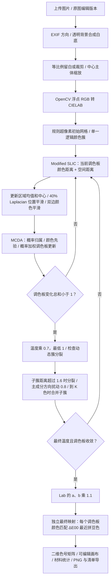

# BeadStudio V3

本地 React + FastAPI 拼豆设计 Demo。当前唯一生成算法为 **V3：PIA 作者源码语义移植 → CIEDE2000 拼豆色卡映射**。运行不需要网络、模型、GPU 或付费 API。

## Windows 启动（开发方式）

在 PowerShell 中执行，保持终端运行，然后访问 **http://127.0.0.1:8000**：

```powershell
cd D:\拼豆子
.\.venv\Scripts\python.exe -m uvicorn backend.main:app --host 127.0.0.1 --port 8000
```

日常使用与首次安装请双击 `start.bat`，具体要求见 [README.md](README.md)。以上命令仅供已有环境的开发调试。

## 整体算法思路



区域分配使用 `Lab 欧氏距离 + 45 / 区域搜索半径 × 空间欧氏距离`。每个输出格子对应一个可以移动的原图区域，区域分配使用当前调色板颜色，而非独立的区域均值，因此空间结构与颜色优化相互影响。MCDA 从单个逻辑簇（内部由两个子簇表示）出发，随收敛降温动态分裂；没有用 K-means 替代 MCDA。

V3 固定采用作者源码语义：初始颜色为平滑超像素均值的平均；初温为 `1.1 × sqrt(2 × 最大特征值)`；主成分矩阵按作者代码使用绝对分量残差；硬颜色归属取允许集合中的最近色。作者代码与论文文字在这些细节上存在差异，本项目选择源码配置，不混用论文配置。默认采用原论文/源码的 1.1 倍 Lab 饱和度后处理。

实现修正了原始代码的未覆盖像素回退、空区域索引、整数权重累计和合并后矩阵类型问题，并使用稳定概率归一化及双精度累计。这是源码语义移植，**没有验证与原版 OpenCV 2.3 可执行程序逐像素一致**。

最终色卡为 **MARD 221 社区数据**，不是官方实测校准数据。只在 PIA 收敛后映射，不把离散色卡加入 MCDA。多个连续颜色可映射到同一色号，所以实际色数可能少于上限；绝不超过上限。默认 48×48、最多12色、等比例留白。界面支持10～100的十倍数边长，并保留32、48、64；后端接受10～100整数正方形尺寸。

`backend/v3/core.py` 还保留 Importance Map、像素允许颜色集合、调色板锁定及 `save/load/run` 续算接口；这些接口暂未提供网页控制。Importance Map 改变超像素先验；续算保留区域、调色板及最终温度，不重新初始化。

## 编辑、历史数据和导出

上传 → 调整/裁剪原图 → V3生成 → 手动画笔、选区、填充或换色 → 保存为新版本 → 导出。原图和旧图纸不会被覆盖。矩形/套索选区、预览确认、撤销重做以及编辑/移动查看模式保留。缩放不围绕鼠标光标。

上传透明区域沿用原规则合成白底；生成结果是完整网格。橡皮擦产生 `null` 空孔，保存/重载保留，材料统计排除空孔，像素PNG对应区域透明。旧 V2 图纸按原演示色卡解释，新 V3 图纸按 MARD 色卡解释，即使存在同名色号也不混色。历史版本、原始上传图片及 SQLite 均保留在 `data/`。

## 工作区

- `backend/main.py`：上传、编辑、版本保存、导出与前端静态托管。
- `backend/generation.py`：唯一 V3 正式生成入口、构图与质量/区域统计。
- `backend/v3/`：PIA 核心、原生空间分配内核及 GPL 许可证。
- `backend/palette.py`、`backend/palettes/`：当前色卡和历史色卡兼容。
- `frontend/src/`、`frontend/dist/`：React 编辑器及可直接托管的构建结果。
- `tests/`、`frontend/test-selection.mjs`：正式流程和选区回归检查。
- `examples/test_images/`：用户提供的0202、hatsune、青龙瓦当原图。
- `examples/anime_avatar.png`：恢复的动漫头像展示原图；`anime_avatar_V3_48.png` 为当前算法实际输出，`anime_avatar_v3_preview.png` 为并排预览。
- `archive/BeadStudio_before_V3.zip`：重构前快照，含 B0、PIA-inspired、PIA-SC、论文配置、TS候选算法、实验脚本/对比图和原作者源码。
- `archive/research_history.zip`：更早的归档历史。两个ZIP已进行完整性检查；运行V3不需要解压。
- `archive/locked_test_cache/`：历史测试缓存因Windows ACL拒绝删除，已整体隔离到归档目录；不参与启动，未修改其安全权限。

旧实验目录、未使用的TS生成器、B0生成代码和临时脚本已从活动工作区移除。没有删除数据库或用户样例。归档和私人样例不提交 Git；前端构建产物与依赖由启动脚本生成。本文件保留算法说明，启动与协作说明见 README。

## 验证及运行边界

```powershell
.\.venv\Scripts\python.exe -m pytest -q
node frontend/node_modules/typescript/bin/tsc frontend/src/selection.ts --outDir frontend/.tests --target ES2022 --module ES2022 --skipLibCheck
node frontend/test-selection.mjs
```

V3对0202的48×48、12色结果与选定实验的PIA→Bead逐像素相同。测试覆盖限色、合法色号、透明输入、10/100尺寸、保存重载、空孔、三类导出、历史色卡颜色以及约束续算。

CPU耗时随输入分辨率、目标网格和收敛轮数增长；100×100或大照片可能较慢，界面会显示处理中。最多2000轮，未收敛会明确报错，不静默换用别的算法。空间核附带当前Windows环境可用的DLL；DLL缺失或需重新编译时需要本机 `g++`（`mapping.cpp` 是无OpenCV C++ SDK依赖的独立内核）。

## 来源与许可证

PIA作者：Timothy Gerstner等。[2012论文](https://cragl.cs.gmu.edu/pixelate/)；[2013论文及作者源码](https://cragl.cs.gmu.edu/pixelate/journal.html)。核心移植遵守 **GPL-3.0-or-later**，完整许可保留在 `backend/v3/LICENSE`，原始源码在归档ZIP中；分发包含该核心的衍生应用时应遵守其许可证要求。没有引入第三方Rust简化算法、Diffusion或深度模型。

`examples/evaluation/`中的照片来自scikit-image的coffee、astronaut（NASA Eileen Collins）和chelsea数据，卡通房屋为本地绘制；[来源信息](https://scikit-image.org/docs/stable/api/skimage.data.html)。
