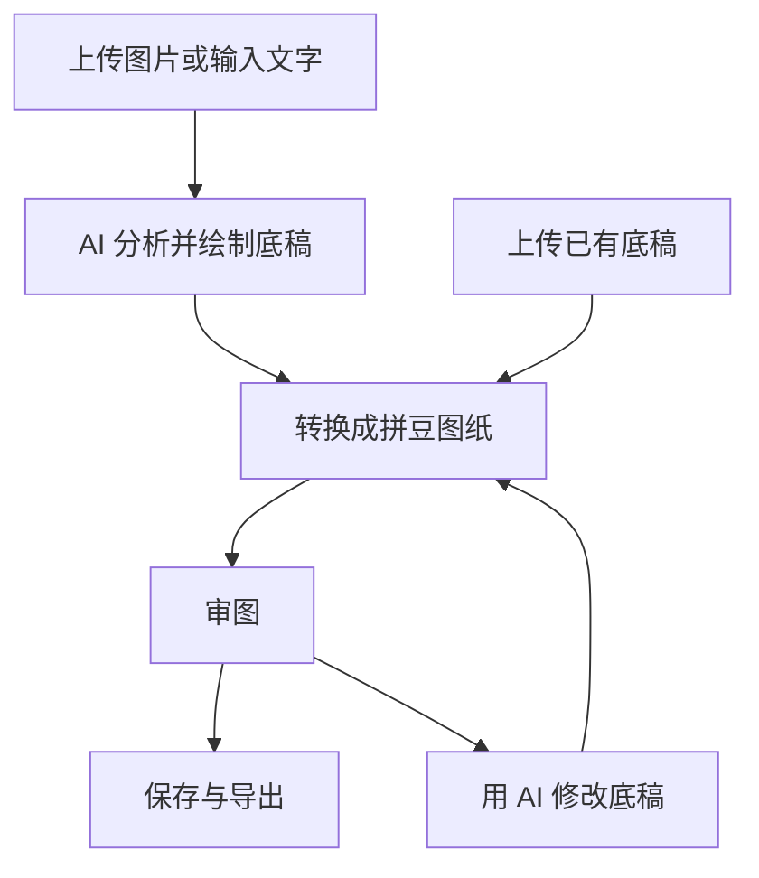

# BeadStudio V3

把图片或文字做成拼豆图纸，生成后可逐格修改、保存和导出。

## 一、启动准备

请先准备以下软件。

- **Python 3.10 或以上版本**，Windows 安装时勾选 **Add Python to PATH**。
- **Node.js 18 或以上版本**，保留默认安装选项，npm 会一并安装。
- Chrome、Edge 等现代浏览器。

## 二、启动步骤

### Windows 64 位

1. 将项目放在本机可写目录，双击 [**start.bat**](start.bat)。
2. 首次启动需要联网安装依赖和构建前端。
3. 浏览器会自动打开，也可以手动访问 **http://127.0.0.1:8000**。
4. 点击「试转示例」，再点「生成图纸」，就能用内置的虎斑猫测试。
5. 使用结束后，双击 [**stop.bat**](stop.bat)。

后续直接双击 `start.bat`。如果 8000 端口被占用，可换用 8001。

```powershell
.\start.bat -Port 8001
```

此时访问 **http://127.0.0.1:8001**。启动失败时查看启动窗口提示，服务日志位于 `.runtime/server-error.log`。

### macOS

在项目根目录运行下面的命令，然后打开 `http://127.0.0.1:8000`。

```bash
python3 -m venv .venv
source .venv/bin/activate
python -m pip install -r requirements.txt
npm ci --prefix frontend
npm run build --prefix frontend
python -m uvicorn backend.main:app --host 127.0.0.1 --port 8000
```

Mac 使用默认的 PinDou 转换。旧版 PIA 照片转换依赖 Windows DLL。

「AI 设计」默认用 DeepSeek V4.1 Flash 看图、GPT Image 2.6 Sunburst 生图。按 [API 接入教程](docs/api.md) 配置两把密钥即可。

## 三、流程图简介



- **AI 设计** 可以上传参考图、填写描述，或同时提供两者。选好方板格数（10–100）和 MARD 色数上限，点击「生成图纸」。
- **底稿直转** 可以直接转换已有图案，透明底 PNG 的透明处会留空。生成后自动进入「审图」。
- **审图** 可以对照上传原图和 AI 底稿。点击「编辑」才显示画笔、橡皮擦等工具。图纸可以保存为新版本，导出编号图纸、像素 PNG 和材料清单。
- **用 AI 修改** 在左侧切到「AI 底稿」后可继续提出修改。系统按原规格重转，用户对比前后再决定保存哪一版。

开发接口可打开 `http://127.0.0.1:8000/docs` 查看。[旧版 PIA 算法说明](ALGORITHM.md)仍可查阅。
