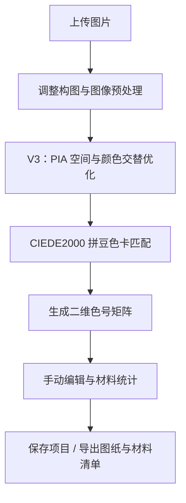

# BeadStudio V3

## 一、启动准备

使用 **Windows 64 位系统**，提前安装：

- **Python 3.10 或以上版本**，安装时勾选 **Add Python to PATH**。
- **Node.js 18 或以上版本**，保留默认安装选项，npm 会一并安装。
- Chrome、Edge 等现代浏览器。

安装后打开新的终端，检查环境：

```powershell
python --version
node --version
npm.cmd --version
```

将项目完整解压到本机可写目录。首次启动需要联网下载依赖，无需手动创建虚拟环境或安装 Python、前端依赖包。

## 二、启动步骤

1. 打开项目文件夹，双击 **start.bat**。
2. 首次启动等待依赖安装和前端构建完成。
3. 浏览器会自动打开；也可以手动访问 **http://127.0.0.1:8000**。
4. 上传图片，调整构图，生成拼豆图纸，再进行手动修改、保存和导出。
5. 使用结束后，双击 **stop.bat**。关闭浏览器不会停止服务。

后续直接双击 `start.bat`，依赖未变化时不会重复安装。如果提示端口被占用，在项目目录的终端中运行：

```powershell
.\start.bat -Port 8001
```

此时访问 **http://127.0.0.1:8001**。启动失败时查看启动窗口提示，服务日志位于 `.runtime/server-error.log`。

## 三、流程图简介



- **交互界面：** React + TypeScript，使用 Konva 绘制和编辑拼豆画布。
- **后端服务：** FastAPI，负责图片处理、算法调用、保存和导出，同时提供网页。
- **生成算法：** PIA 作者源码语义移植，通过超像素区域和调色板交替优化生成低分辨率图像，再用 CIEDE2000 映射到项目色卡。
- **数据存储：** SQLite + 本地文件，保存图片、图纸矩阵和版本记录。
